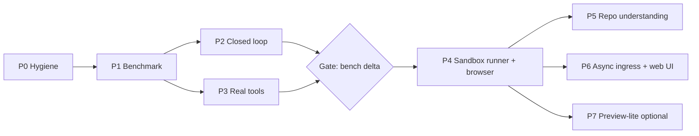

# 17 — Completeness assessment and parity roadmap (vs. Devin / Lovable)

**Status:** proposal. No production code was changed to produce this document.
**Reviewed at:** branch `claude/dreamy-rubin-5tnzfg` @ `cfd8ed8` (package `1.3.0`).
**Baseline measured:** `pnpm test` → 88 files, 1222 passed / 3 skipped.
`pnpm typecheck` → **fails** (2 errors, see §2.4).

---

## 1. Framing: what "parity" should mean

Devin and Lovable are not the same kind of product, and Bremio is a third kind.

| | Devin | Lovable | Bremio (today) |
|---|---|---|---|
| Core identity | Autonomous cloud software engineer | Prompt → full-stack web app builder | Local, provider-agnostic control plane over existing agent CLIs |
| Who owns the agent loop | Devin (own model loop + tools) | Lovable (own loop) | The provider CLI (Claude/Codex/agy/OpenCode); Bremio orchestrates and governs |
| Execution environment | Per-session cloud VM: shell, editor, browser | Hosted sandbox + live preview + hosting | User's machine, git worktrees |
| Primary user | Engineering teams, async delegation | Non-developers / founders | One developer juggling several subscriptions |
| Entry points | Slack, web app, GitHub/Linear, API | Web app | CLI, Ink TUI, VS Code panel |
| Long-horizon autonomy | Hours; iterates until tests/CI pass | Iterates on preview feedback | One plan, one execution pass, stop |
| Differentiator | Autonomy + environment | Time-to-visible-app | Multi-provider routing, quota ROI, policy/approval/audit |

**Consequence.** Full parity with *both* is not one roadmap; it is two products.
Lovable parity requires an app-builder runtime (hosting, managed DB, visual
editor, non-developer UX) that is orthogonal to everything Bremio has built.
Devin parity requires closing an **autonomy** and **environment** gap that sits
directly on top of what Bremio already has. This document therefore treats
"Devin-class" as the target and takes from Lovable only what compounds with it
(live preview + browser verification).

---

## 2. Completeness assessment

### 2.1 Scorecard

Scale 0–5, where 5 = on par with the reference product on that axis.

| # | Axis | Score | Evidence |
|---|---|---:|---|
| A | Orchestration core (plan → assign → isolate → execute → aggregate) | **4.0** | Validated DAG, parallel scheduler, worktree isolation, multi-worker routing, dynamic microtasks behind a flag (`packages/orchestrator`) |
| B | Safety & governance (policy, approvals, audit, plan mode) | **4.5** | `packages/policy` matrix, approval lifecycle, action digest, runtime guard, review-before-apply. Arguably *ahead* of Devin |
| C | Session & state (durable sessions, resume, fork, queue) | **4.0** | Daemon SQLite as single source of truth, session config revisions, provider bindings, fork lineage, prompt queue |
| D | Change transparency & git workflow | **3.5** | Change ledger, attribution, diff viewer, per-file apply/revert, stage/commit/branch/push/PR via `gh` |
| E | Cost/quota ROI measurement | **4.0** | Ledger, net-gain, calibration gate, `compare`, AQT capacity. Unique — neither reference product exposes this |
| F | **Autonomy loop** (verify → diagnose → fix → re-verify) | **1.0** | Only the *plan JSON* gets one repair attempt (`lead-manager.ts`). A failed quality gate ends the run (`run.ts` `runPlan` → `buildReport` → return; no iteration) |
| G | **Execution environment** (sandbox, cloud, reproducible setup) | **1.0** | Local worktrees only. Codex has an OS sandbox; Antigravity write mode is not contained (`docs/99` R3). No container/VM runner, no env recipe |
| H | **Tools actually reachable by agents** (MCP, web search, skills, hooks) | **1.0** | Sprint 8 tools exist and are policy-bound, but `apps/daemon/src/runs.ts` constructs `RunToolset` and nothing consumes it (its own comment says "inert"). Every adapter reports `mcp: false`. `WebSearchTool` targets DuckDuckGo's Instant Answer API, which is not a web search |
| I | Codebase understanding (repo map, knowledge, retrieval) | **1.0** | Planning prompt is the raw user request + rules (`plan-schema.ts` `buildPlanningPrompt`). Memory is tag/recency only. No repo map, no project wiki |
| J | Async ingress (GitHub issues, PR review comments, CI, Slack, schedules) | **0.5** | Outbound PR creation only. Inbound triggers explicitly "Not scheduled" (`TASKS.md`) |
| K | Browser / preview / visual verification | **0.0** | `browser`/`vision` exist as capability tokens; nothing exercises a browser or a dev server |
| L | Surfaces & UX | **2.5** | CLI + TUI + VS Code panel. No web app/mobile. Webview is a 2665-line string-templated HTML file (`webview.ts`) |
| M | Engineering health & release | **3.0** | 1222 tests, release gate, fresh-install E2E — but **typecheck is red on HEAD, no CI exists** (no `.github/`), version strings drift (§2.4) |
| N | Outcome evaluation (task-success benchmark) | **1.0** | Calibration measures cost vs. single baseline on the user's own runs; there is no fixed benchmark that says "Bremio resolves X% of tasks" |

**Weighted read-out.** Against a Devin-class target Bremio is roughly
**45–50 % complete**: the control plane (A–E) is mature, the agent (F–K) is
immature. Against Lovable it is **~10–15 %**, and most of the missing part is
out of Bremio's stated scope (`docs/00` non-goals).

### 2.2 What is genuinely strong (keep, do not rework)

- **Honest, fail-closed semantics** (`docs/15`): no silent provider
  substitution, unknown stays unknown, enforcement in code not prompts.
- **Daemon as single source of truth** with store-then-publish SSE replay.
- **Capability-shaped adapters** (`AgentCapabilities` +
  `AdapterRuntimeCapabilities`) — the correct seam for adding new runtimes.
- **Measured ROI** (ledger + calibration) — a real differentiator; use it as the
  gate for every phase below.

### 2.3 Structural gaps (ordered by leverage)

1. **No closed loop.** Devin's core value is "keep going until it is green". Bremio
   stops at the first red gate and hands the user a failed report.
2. **Tools are built but not delivered.** MCP/hooks/skills/web search pass their
   own tests and reach no agent. This is the largest "looks done, isn't" area.
3. **No controlled environment.** Without a container/VM runner there is no
   safe autonomy for non-sandboxed providers, no reproducible setup, no cloud
   mode, and no browser.
4. **No repo understanding.** Plans are made from a cold start every time,
   which caps plan quality regardless of the model.
5. **No outcome benchmark.** Without one, none of the above can be shown to
   help, which contradicts Bremio's own principle P3 ("measure net, not gross").
6. **Only synchronous, local entry points.** Devin's adoption comes from
   "assign it from Slack/GitHub and walk away".

### 2.4 Hygiene defects found during this review

| Defect | Evidence | Fix size |
|---|---|---|
| Typecheck red on HEAD | `packages/event-view/src/index.ts:120,123` read `event.taskId`, which the event type lacks (introduced by the two S13-T7 commits) | S |
| No CI | No `.github/workflows`; the release gate only runs when someone remembers | S |
| Version drift | `README.md` says "`1.0.0` is a locally packaged release" and installs `bremio-1.2.0.tgz`; `package.json` is `1.3.0` | S |
| Task board drift | `S9-T7`/`S9-T8` still `[ ]` although S12-T1/T3 closed them per their own rows | S |
| Coordination files are very large | `PROGRESS.md` 209 KB, `SPRINT-LOG.md` 99 KB — expensive context for every agent that "reads first" | S |
| Webview maintainability | `apps/vscode-extension/src/webview.ts` 2665 lines of string-built HTML/CSS/JS | M |
| Web search endpoint | DuckDuckGo Instant Answer API returns abstracts, not result lists | S (part of P3) |

---

## 3. Strategic options

### Option A — Devin-class governed autonomous engineer, multi-provider (**recommended**)

Close gaps F, G, H, I, J, K(browser only), N. Keep Bremio's identity: it still
drives provider agents, but it now owns the **outer loop** (verify/fix/replan),
the **environment** (sandbox runner), and the **ingress** (GitHub/Slack).

- **Pros:** compounds on existing strengths (policy, ledger, daemon); unique
  positioning ("Devin, but uses the subscriptions you already pay for, with
  auditable approvals"); every step is measurable via the benchmark.
- **Cons:** ~4–6 months of focused work; cloud mode raises provider-ToS and
  credential questions (§6).

### Option B — Full parity with Devin *and* Lovable

Option A plus hosting, managed DB integration, visual editor, templates,
non-developer web UX.

- **Pros:** largest addressable market.
- **Cons:** roughly 2–3× the effort of A; abandons the "not a new AI coding
  tool" boundary; competes head-on with well-funded products on their home
  turf; the existing differentiators do not help on the Lovable axes.

### Option C — Stay a control plane, deepen the moat

Only phases P0–P3 below: hygiene, benchmark, closed loop, real tools.

- **Pros:** ~6–8 weeks; highest ROI per week; keeps scope local and safe.
- **Cons:** remains a power-user tool; no async/cloud story, so it will not
  feel "Devin-like" to a team.

**Recommendation:** commit to **C now** (P0–P3), and treat P4–P7 as **Option A,
gated by benchmark evidence** at the end of P3. That is the 80/20: P0–P3 fix
the two gaps that most affect task success (closed loop, real tools) for
roughly a quarter of the total effort, and P1's benchmark decides whether the
heavier environment/ingress investment is worth it.

---

## 4. Roadmap

Sizes: S ≤ ½ day · M ≈ 1 day · L 2–3 days · XL = split before starting.
Week estimates assume one developer working with coding agents; treat them as
±50 %. Every phase ends with `corepack pnpm release:check` green **and** a
benchmark run compared against the previous phase's numbers.

### P0 — Hygiene and truth (≈1 week)

| ID | Task | Size | Acceptance |
|---|---|---|---|
| P0-T1 | Fix `event-view` typecheck (add `taskId` to the event shape or narrow by `type`) | S | `pnpm typecheck` green; a test renders `task-start`/`task-complete` with and without `taskId` |
| P0-T2 | GitHub Actions: typecheck + test + build on `ubuntu-latest` and `windows-latest`, Node 22; `release:smoke` on Ubuntu | M | PRs show required checks; a deliberately broken type fails CI |
| P0-T3 | Single version source: README/CHANGELOG/extension read from `package.json`; fix the `1.0.0`/`1.2.0` strings | S | `grep` finds no stale version; release-smoke asserts README version matches |
| P0-T4 | Reconcile `TASKS.md` (tick S9-T7/S9-T8 with references to S12-T1/T3) | S | Board matches commits |
| P0-T5 | Archive `PROGRESS.md`/`SPRINT-LOG.md` per sprint into `docs/archive/`; keep a ≤ 20 KB live file | S | `AGENT-WORKFLOW.md` points to the live file; no content lost |
| P0-T6 | Decide the fate of inert Sprint 8 tools: keep (then P3 wires them) or remove. Until P3 lands, `bremio doctor` prints "MCP/hooks/skills: not delivered to agents" | S | No surface implies a tool reaches an agent when it does not |

### P1 — Outcome benchmark `bremio-bench` (≈1.5–2 weeks)

Build this **before** any capability work. It is the gate for everything after.

| ID | Task | Size | Acceptance |
|---|---|---|---|
| P1-T1 | Bench format: `bench/<case>/` = repo fixture (git bundle), prompt, hidden verification command, optional time/cost budget | M | Schema in `packages/protocol`; 3 seed cases run locally |
| P1-T2 | Seed suite of 25–40 cases across: bug fix, feature add, refactor, test writing, multi-file change, docs; TS + Python; small/medium repos. Optionally a 20–50 case subset of a public SWE-style dataset | L | Each case has a reference solution that passes and a baseline that fails |
| P1-T3 | Runner: `bremio bench run --mode single|team --agent/--lead … --cases …`; isolated copy per case; executes hidden verification **outside** the agent's worktree | L | Resolve/fail recorded per case; agent never sees the hidden test |
| P1-T4 | Report: resolve rate, provider-reported cost/tokens, wall time, human interventions, gate pass rate; diff vs. previous run; stored in the ledger as `scope: bench` | M | `bremio bench report --compare <runA> <runB>` prints deltas with unknowns preserved |
| P1-T5 | Nightly/dispatch CI job for a cheap subset (opt-in secret, never on PRs) | S | Quota is spent only on explicit dispatch or schedule |

**Exit criterion:** a baseline number for Single(claude), Single(codex),
Team(claude→codex) on the suite.

### P2 — Closed autonomy loop (≈2–3 weeks)

The single most important capability gap.

| ID | Task | Size | Acceptance |
|---|---|---|---|
| P2-T1 | `RunOutcome.errorCode` end-to-end (already listed as "Not scheduled"): adapters transmit `classifyAgentError` results | M | Loop logic switches on codes, never on message strings |
| P2-T2 | **Plan checkpoint**: optional `--review-plan` pauses after planning; user can approve, edit (JSON or structured UI), or reject; edits validated by `validatePlan` | L | CLI + panel; non-interactive runs default to approve-unless-policy-denies; edit is recorded as an audit event |
| P2-T3 | **Fix loop (Team)**: when the quality gate fails, synthesize a `fix` task from the evidence (failing command + tail of output, reviewer findings), assigned per routing, depending on the failed implementation branch; re-run test + review | L | Bounded by `maxFixIterations` (default 2), cost budget, and runtime-guard state; each iteration is a ledger entry; gate re-evaluated per iteration |
| P2-T4 | **Fix loop (Single)**: after the agent finishes, run the declared/verified test command; on failure, resume the provider session with the failure evidence | M | Uses `resumeRun` where `resumableSessions`; otherwise a fresh turn with prior-turn context; bounded like P2-T3 |
| P2-T5 | **Re-plan on blocker**: if a task fails with a non-retryable code or a named blocker, ask the lead for a revised plan for the remaining graph only (completed tasks immutable) | L | Never re-runs completed work; at most N re-plans; recorded as a transition with reason |
| P2-T6 | **Definition of done**: run-level acceptance contract = plan acceptance criteria + verification command(s) + optional user-supplied check; final report says which criteria are met with evidence | M | Report lists each criterion → evidence/unknown |
| P2-T7 | Auto-PR on green (opt-in): when the gate passes, push branch and open PR with a generated description (summary, evidence, cost) | M | Reuses S10-T12/T13 policy gates; never under plan mode |

**Gate:** resolve rate on `bremio-bench` improves over P1 baseline at
acceptable cost (use the existing net-gain arithmetic; unknown cost blocks the
claim, as today).

### P3 — Make the tools real (≈2 weeks, parallel with P2)

| ID | Task | Size | Acceptance |
|---|---|---|---|
| P3-T1 | **MCP pass-through per adapter**: Claude Agent SDK `mcpServers`, Codex config `mcp_servers`, OpenCode config; servers come from the S8-T3 manifest; tool calls classified via `McpPermissionGuard` | L | `getRuntimeCapabilities().mcp` true only where a fixture proves a call reached the agent; policy denial is observable in events |
| P3-T2 | **Hooks on real lifecycle points**: pre-plan, pre-task, post-task, pre-apply, pre-merge, with veto | M | A veto hook stops the action with a named reason in CLI and panel |
| P3-T3 | **Skills = playbooks**: skill content injected into lead/worker prompts under the context budget (Devin "Playbooks" equivalent); selectable per run/session | M | Injection is visible in the turn inspector with token cost |
| P3-T4 | **Web search**: prefer provider-native search where the adapter supports it; otherwise a pluggable search backend (configurable API) replacing the Instant Answer endpoint | M | Returns ranked result lists; network policy gate unchanged |
| P3-T5 | **Bremio-provided tools via an MCP server**: expose Bremio's own tools (artifact read, blackboard post, ask-lead, request-approval) as a local MCP server the agents connect to — this is how Bremio gains mediation without owning the model loop | L | Agents can post blockers/artifacts mid-task; every call passes policy + audit |

P3-T5 is the architectural unlock: it turns ADR-1 option A from "observe" into
"mediate through tools" for every MCP-capable provider.

### Decision gate (end of P3)

Proceed to P4+ only if: (1) P2/P3 moved the benchmark, (2) the user still wants
async/cloud usage, and (3) the provider-terms question (§6, R1) has an answer.
Otherwise stop at Option C and invest in polish.

### P4 — Execution environment: sandbox runner + browser (≈3–4 weeks)

| ID | Task | Size | Acceptance |
|---|---|---|---|
| P4-T1 | `WorkspaceStrategy: "container"`: run a task's agent CLI inside a Docker/devcontainer image with the worktree bind-mounted; network policy (none / allowlist / full) | XL → split | Antigravity/OpenCode write paths become `hard-sandbox`; outside-workspace sentinel fixtures (S3-T9) pass in-container |
| P4-T2 | Environment recipe: read `.devcontainer/devcontainer.json` or `.bremio/env.yaml` (image, setup script, services); cache prepared images | L | Same recipe works for bench, local and cloud |
| P4-T3 | Secrets injection: per-repo secrets from OS keychain → env of the sandbox only; redacted in events | M | Secrets never in `run_events`, ledger, or reports (test with sentinel value) |
| P4-T4 | **Browser tool**: Playwright (via MCP from P3-T1) inside the sandbox; screenshots stored as run artifacts and shown in the panel | L | A UI task's review step can attach screenshot evidence |
| P4-T5 | Remote runner interface: same protocol against a remote host (self-hosted VM first; managed sandbox providers as adapters later) | XL → split | A run can execute on a remote runner with identical events/policy |

### P5 — Codebase understanding (≈2 weeks)

| ID | Task | Size | Acceptance |
|---|---|---|---|
| P5-T1 | Repo map: file tree + symbol outline (tree-sitter or ctags) + import graph, cached per commit | L | Map for a 2k-file repo builds in < 30 s and fits a configurable token budget |
| P5-T2 | Feed the map (budgeted) into `buildPlanningPrompt` and task prompts (relevant slice per task) | M | Bench: plan validity and resolve rate do not regress; measured token cost |
| P5-T3 | Project knowledge: generate and maintain `AGENTS.md`/wiki pages from the repo (build/test commands, conventions); stored as reviewed project memory | M | Proposals go through the existing review lifecycle |
| P5-T4 | Retrieval benchmark for memory; add embeddings **only** if it shows tags/recency miss | M | Decision recorded with numbers (keeps `docs/16` rule) |

### P6 — Async ingress and team surfaces (≈3–4 weeks)

| ID | Task | Size | Acceptance |
|---|---|---|---|
| P6-T1 | Daemon remote mode: authenticated (token/OIDC) non-loopback listener, replay protection, rate limits, repo authorization, emergency disable | L | Threat model doc; loopback mode unchanged |
| P6-T2 | GitHub App/webhook: issue label or `/bremio` comment → run → PR; replies with status | L | Idempotent per delivery id; repo allowlist |
| P6-T3 | **PR follow-up**: subscribe to review comments and CI failures on Bremio PRs → fix loop (P2-T3) → push | L | Never rewrites history; bounded iterations; every push audited |
| P6-T4 | Slack/Linear ingress (one first, whichever the user actually uses) | M | Same ingress interface as P6-T2 |
| P6-T5 | Schedules (cron-style recurring runs, e.g. dependency bumps, flaky-test triage) | M | Uses the prompt queue; disable switch |
| P6-T6 | Web dashboard (read + approve): sessions, live events, approvals, diffs — reusing `event-view`; usable from a phone | L | Approvals from web reach the same daemon state machine |
| P6-T7 | Replace string-built webview with a component build (Preact/React + esbuild) shared with the web dashboard | L | Drift test against `event-view` retained; VSIX size budget |

### P7 — Lovable-lite (optional, ≈2 weeks; only if web-app work is a real use case)

| ID | Task | Size | Acceptance |
|---|---|---|---|
| P7-T1 | Live preview: detect/start the dev server in the sandbox, forward the port, show in panel/web UI | L | Restarts on agent changes; logs captured as events |
| P7-T2 | Visual feedback loop: user clicks/annotates a screenshot → becomes a context item for the next turn | M | Uses existing `ContextItem` image type with `vision` gating |
| P7-T3 | Starter templates (e.g. Vite + React + Tailwind, FastAPI) as bench-validated recipes | M | Each template passes its own bench case |
| — | Hosting, managed DB, visual style editor | — | **Out of scope** — that is Option B |

---

## 5. Summary timeline

| Phase | Weeks (±50 %) | Cumulative | Expected scorecard movement |
|---|---:|---:|---|
| P0 | 1 | 1 | M 3.0 → 4.0 |
| P1 | 1.5–2 | 3 | N 1.0 → 3.5 |
| P2 | 2–3 | 6 | F 1.0 → 3.5 |
| P3 | 2 (‖ P2) | 6–7 | H 1.0 → 3.5 |
| — | **Gate** | | |
| P4 | 3–4 | 11 | G 1.0 → 3.5, K 0 → 2.0 |
| P5 | 2 | 13 | I 1.0 → 3.0 |
| P6 | 3–4 | 17 | J 0.5 → 3.0, L 2.5 → 3.5 |
| P7 | 2 (optional) | 19 | K 2.0 → 3.0 |

After P6, Bremio would sit at roughly **75–80 %** of a Devin-class product
while keeping two axes (governance, ROI measurement) where it leads.

---

## 6. Risks

| # | Risk | Mitigation |
|---|---|---|
| R1 | **Provider terms**: running consumer subscription CLIs (Claude Code login, Codex, `agy`) unattended on a server or for a team may not be permitted by the providers' terms | Cloud/remote mode (P4-T5, P6) uses API-key auth per provider; subscription auth stays local-only until each provider's terms are verified |
| R2 | Fix loops double-pay (`docs/99` R5) | Hard iteration + cost budgets, runtime guard, net-gain gate; bench measures cost per resolved task, not just resolve rate |
| R3 | Remote ingress widens the attack surface (prompt injection via issues/PR comments) | Repo allowlist, author allowlist, plan checkpoint required for untrusted sources, sandbox-only execution, no secrets in prompts |
| R4 | Scope creep (`docs/99` R6) repeats | Each phase is gated by benchmark deltas; P7 and Option B require an explicit decision |
| R5 | Benchmark overfitting | Keep a held-out subset; rotate cases; include the user's real repos |
| R6 | Container runner on Windows (primary dev OS) | Docker Desktop/WSL2 path first; keep worktree strategy as default fallback with honest capability labels |

---

## 7. Open questions for the owner

1. Is the target user still "me, one developer", or a team? (Decides whether P6 is in scope.)
2. Is web-app building (P7) a real use case or a nice-to-have?
3. Acceptable monthly quota/cost budget for the benchmark (P1-T5)?
4. Keep or delete the inert Sprint 8 surfaces if P3 is deferred (P0-T6)?
